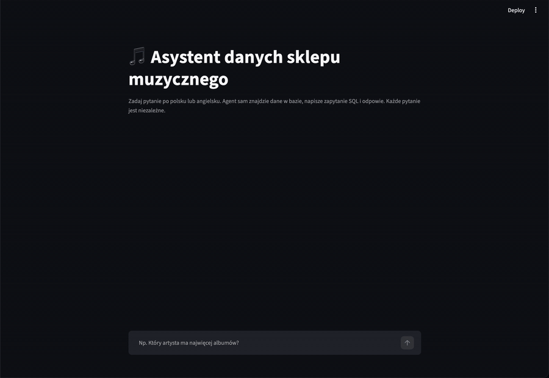
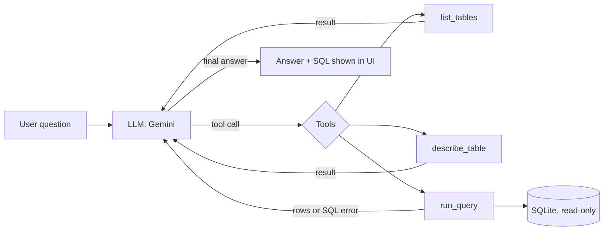

# SQL Agent LLM

**English** | [Polski](README.pl.md)

An AI agent that answers business questions about a SQL database in plain language.
A non-technical employee asks *"Which 3 customers spent the most?"* and the agent explores
the database, writes the SQL query, runs it, fixes it if it fails, and answers in a sentence.

Built with Python and the Gemini API using **tool calling** and a hand-written agent loop
(no agent framework), so every step of the agent's reasoning is visible and testable.



*Chat UI (in Polish) in fast mode. Under each answer you can expand the agent's steps:
the SQL it wrote and the query result.*

## Highlights

- **Agentic workflow**: the model decides which tool to call (`list_tables`, `describe_table`,
  `run_query`) and loops until it has the answer, up to a step limit.
- **Self-correction**: SQL errors are returned to the model as tool results, so it can read
  the error and retry with a fixed query.
- **Defense in depth**: queries are validated (single `SELECT` only, row limit) **and** the
  database is opened read-only, so even a query that slips past validation cannot modify data.
- **Evaluation suite**: 27 questions with known answers (easy → hard, plus typos, English
  and a hallucination trap), automatically scored. Reference queries are checked against the
  database before each run ("testing the tests").
- **Two agent modes compared with data**: discovering the schema with tools vs. putting the
  schema in the system prompt.
- **Resilience**: exponential backoff for overloaded servers (503) and rate-limit aware
  retries (429) that use the server's suggested retry delay.
- **Chat UI** in Streamlit that shows the agent's steps, generated SQL and query results.
- **Unit tests + CI**: 25 pytest tests run on every push via GitHub Actions (no API key needed).

## How it works



The LLM API is stateless, so the agent keeps the whole conversation (question, tool calls,
tool results) in a history list and sends it with every request.

## Evaluation results

Model: `gemini-3.1-flash-lite` (free tier). Dataset: Chinook sample database
(digital music store, 11 tables). 27 questions: 6 easy, 6 medium, 10 hard, 5 unusual.

| Mode | Correct | Avg. tool calls | Avg. input tokens | Total time* |
|---|---|---|---|---|
| Tools (agent discovers the schema) | **27/27** ** | 3.6 | ~4,300 | 450 s |
| Schema in system prompt | 26/27 | **1.0** | **~3,230** | **247 s** |

\* Includes pauses between questions to respect free-tier rate limits.
\** 25/25 in the first run plus 2 questions that hit API rate limits (HTTP 429) and were
re-run separately (2/2 correct). API errors are reported separately from wrong answers.

### Findings

- **Schema in the prompt is ~3.5× fewer tool calls and ~25% fewer tokens**, with almost
  the same accuracy. It only works because the schema is small (~720 tokens); for a database
  with hundreds of tables the tool-based discovery (or retrieval of relevant tables) is needed.
- **The evaluation caught a confident but wrong answer.** In schema mode the agent computed
  "percent of tracks never sold" as 40.41% instead of 43.36%. It used `LEFT JOIN` with
  `COUNT(Track.TrackId)`, so tracks sold several times were counted several times in the
  denominator (classic join fan-out). In tools mode the agent used a `NOT IN` subquery and got
  it right. One case is not proof, so this is a hypothesis to test with more questions,
  not a conclusion.
- I did **not** add a prompt hint for this specific bug, because tuning the prompt to a known
  test question would overfit the benchmark.
- **Hallucination trap passed**: asked about invoices from 2014 (no such data), the agent
  answered that there are none instead of inventing a number.

Full per-question results (answers, generated SQL, tokens) are in [`eval/wyniki/`](eval/wyniki).

## Quick start

Requirements: Python 3.11+ and a free Gemini API key from [Google AI Studio](https://aistudio.google.com).

```bash
git clone https://github.com/Reith711/SQL-Agent-LLM.git
cd SQL-Agent-LLM
python3 -m venv .venv
source .venv/bin/activate
pip install -r requirements.txt
echo "GEMINI_API_KEY=your_key_here" > .env
```

Run it:

```bash
streamlit run app.py              # chat UI in the browser
python agent.py                   # chat in the terminal (tools mode)
python agent.py --schemat         # chat in the terminal (schema-in-prompt mode)
python ewaluacja.py               # evaluation, tools mode
python ewaluacja.py --schemat     # evaluation, schema mode
python ewaluacja.py --id 19 21    # re-run selected questions only
pytest -v                         # unit tests (no API key needed)
```

## Project structure

| Path | What it is |
|---|---|
| `agent.py` | The agent: tools, tool descriptions, agent loop, retries, terminal chat |
| `app.py` | Streamlit chat UI (presentation only, logic lives in `agent.py`) |
| `ewaluacja.py` | Evaluation runner and answer scoring |
| `eval/pytania.json` | 27 test questions with expected values and reference SQL |
| `eval/wyniki/` | Saved evaluation runs |
| `tests/` | Unit tests for the tools and the scoring logic |
| `data/chinook.db` | Chinook sample database (SQLite) |
| `steps/` | First learning steps: a single LLM call, then a single tool call |

Code comments are written in Polish.

## Limitations and next steps

- Each question is independent: the agent has no memory of previous questions in the chat.
- Free-tier rate limits slow down evaluation runs.
- Next: compare more models, add harder multi-step questions, add conversation memory,
  try the same agent with LangGraph to compare a framework with the hand-written loop.

## Credits

Sample data: [Chinook Database](https://github.com/lerocha/chinook-database) by Luis Rocha.

Author: Konrad Jastrzębski · [GitHub](https://github.com/Reith711)
