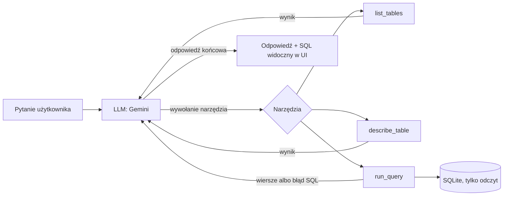

# SQL Agent LLM

[English](README.md) | **Polski**

Agent AI, który odpowiada na pytania biznesowe o bazę danych SQL zadane zwykłym językiem.
Pracownik bez znajomości SQL pyta *„Którzy 3 klienci wydali najwięcej?”*, a agent sam przegląda
bazę, pisze zapytanie SQL, wykonuje je, poprawia, jeśli rzuci błąd, i odpowiada zdaniem.

Zbudowany w Pythonie na Gemini API z użyciem **tool calling** i własnej pętli agenta
(bez frameworka), dzięki czemu każdy krok rozumowania agenta jest widoczny i testowalny.

> GIF z demo: *wkrótce*

## Najważniejsze cechy

- **Workflow agentowy**: model sam decyduje, które narzędzie wywołać (`list_tables`,
  `describe_table`, `run_query`), i działa w pętli, aż zdobędzie odpowiedź (z limitem kroków).
- **Samonaprawa**: błędy SQL wracają do modelu jako wynik narzędzia, więc model może przeczytać
  błąd i spróbować ponownie z poprawionym zapytaniem.
- **Ochrona wielowarstwowa (defense in depth)**: zapytania są sprawdzane (tylko jedno `SELECT`,
  limit wierszy), **a do tego** baza jest otwierana tylko do odczytu, więc nawet zapytanie, które
  prześlizgnie się przez sprawdzenie, nie zmieni danych.
- **Ewaluacja**: 27 pytań ze znanymi odpowiedziami (od łatwych do trudnych, plus literówki,
  pytanie po angielsku i pułapka na halucynacje), oceniane automatycznie. Przed każdym
  przebiegiem wzorcowe zapytania są sprawdzane na bazie („test testów”).
- **Dwa tryby agenta porównane na danych**: odkrywanie schematu narzędziami kontra schemat
  bazy podany od razu w instrukcji systemowej.
- **Odporność na błędy API**: ponawianie z rosnącym odstępem przy przeciążeniu serwera (503)
  i przy limicie zapytań (429) z wykorzystaniem czasu oczekiwania podanego przez serwer.
- **Okienko czatu** w Streamlit, które pokazuje kroki agenta, wygenerowany SQL i wyniki zapytań.
- **Testy jednostkowe i CI**: 25 testów pytest uruchamianych przy każdym pushu przez
  GitHub Actions (bez klucza API).

## Jak to działa



API modelu jest bezstanowe (model nie pamięta poprzednich zapytań), więc agent trzyma całą
rozmowę (pytanie, wywołania narzędzi, ich wyniki) na liście i wysyła ją przy każdym zapytaniu.

## Wyniki ewaluacji

Model: `gemini-3.1-flash-lite` (darmowy plan). Dane: przykładowa baza Chinook
(sklep z muzyką cyfrową, 11 tabel). 27 pytań: 6 łatwych, 6 średnich, 10 trudnych, 5 nietypowych.

| Tryb | Poprawne | Śr. wywołań narzędzi | Śr. tokenów wejściowych | Łączny czas* |
|---|---|---|---|---|
| Narzędzia (agent sam odkrywa schemat) | **27/27** ** | 3,6 | ~4300 | 450 s |
| Schemat w instrukcji systemowej | 26/27 | **1,0** | **~3230** | **247 s** |

\* Wliczone przerwy między pytaniami ze względu na limity darmowego planu.
\** 25/25 w pierwszym przebiegu oraz 2 pytania, które trafiły na limit API (HTTP 429)
i zostały powtórzone osobno (2/2 poprawne). Błędy API są liczone osobno od błędnych odpowiedzi.

### Wnioski

- **Schemat w instrukcji to ok. 3,5 raza mniej wywołań narzędzi i ok. 25% mniej tokenów**
  przy prawie tej samej skuteczności. Działa to tylko dlatego, że schemat jest mały
  (ok. 720 tokenów). Przy bazie z setkami tabel potrzebne jest odkrywanie narzędziami
  (albo wyszukiwanie tylko potrzebnych tabel).
- **Ewaluacja wykryła pewną siebie, ale błędną odpowiedź.** W trybie schematu agent policzył
  „procent utworów, które nigdy się nie sprzedały” jako 40,41% zamiast 43,36%. Użył `LEFT JOIN`
  z `COUNT(Track.TrackId)`, więc utwory sprzedane kilka razy liczyły się w mianowniku kilka razy
  (klasyczne zwielokrotnienie wierszy przy złączeniu). W trybie narzędzi agent użył podzapytania
  `NOT IN` i odpowiedział poprawnie. Jeden przypadek to nie dowód, więc to hipoteza do sprawdzenia
  na większej liczbie pytań, a nie wniosek.
- **Nie** dodałem do instrukcji wskazówki pod ten konkretny błąd, bo dopasowywanie promptu pod
  znane pytanie testowe byłoby przeuczeniem pod test (overfitting).
- **Pułapka na halucynacje zaliczona**: zapytany o faktury z 2014 roku (takich danych nie ma),
  agent odpowiedział, że ich nie ma, zamiast wymyślić liczbę.

Pełne wyniki dla każdego pytania (odpowiedzi, wygenerowany SQL, tokeny) są w [`eval/wyniki/`](eval/wyniki).

## Szybki start

Wymagania: Python 3.11+ i darmowy klucz Gemini API z [Google AI Studio](https://aistudio.google.com).

```bash
git clone https://github.com/Reith711/SQL-Agent-LLM.git
cd SQL-Agent-LLM
python3 -m venv .venv
source .venv/bin/activate
pip install -r requirements.txt
echo "GEMINI_API_KEY=twoj_klucz" > .env
```

Uruchomienie:

```bash
streamlit run app.py              # okienko czatu w przeglądarce
python agent.py                   # czat w terminalu (tryb narzędzi)
python agent.py --schemat         # czat w terminalu (tryb schematu)
python ewaluacja.py               # ewaluacja, tryb narzędzi
python ewaluacja.py --schemat     # ewaluacja, tryb schematu
python ewaluacja.py --id 19 21    # powtórzenie wybranych pytań
pytest -v                         # testy jednostkowe (bez klucza API)
```

## Struktura projektu

| Ścieżka | Co to jest |
|---|---|
| `agent.py` | Agent: narzędzia, ich opisy, pętla agenta, ponawianie, czat w terminalu |
| `app.py` | Okienko czatu w Streamlit (tylko wygląd, logika jest w `agent.py`) |
| `ewaluacja.py` | Uruchamianie ewaluacji i ocena odpowiedzi |
| `eval/pytania.json` | 27 pytań testowych z oczekiwanymi wartościami i wzorcowym SQL |
| `eval/wyniki/` | Zapisane przebiegi ewaluacji |
| `tests/` | Testy jednostkowe narzędzi i logiki oceny |
| `data/chinook.db` | Przykładowa baza Chinook (SQLite) |
| `steps/` | Pierwsze kroki nauki: jedno wywołanie LLM, potem jedno wywołanie narzędzia |

## Ograniczenia i dalsze kroki

- Każde pytanie jest niezależne: agent nie pamięta poprzednich pytań w czacie.
- Limity darmowego planu spowalniają ewaluację.
- Dalej: porównanie większej liczby modeli, trudniejsze pytania wieloetapowe, pamięć rozmowy,
  ten sam agent w LangGraph, żeby porównać framework z własną pętlą.

## Źródła

Dane przykładowe: [Chinook Database](https://github.com/lerocha/chinook-database), autor Luis Rocha.

Autor: Konrad Jastrzębski · [GitHub](https://github.com/Reith711)
